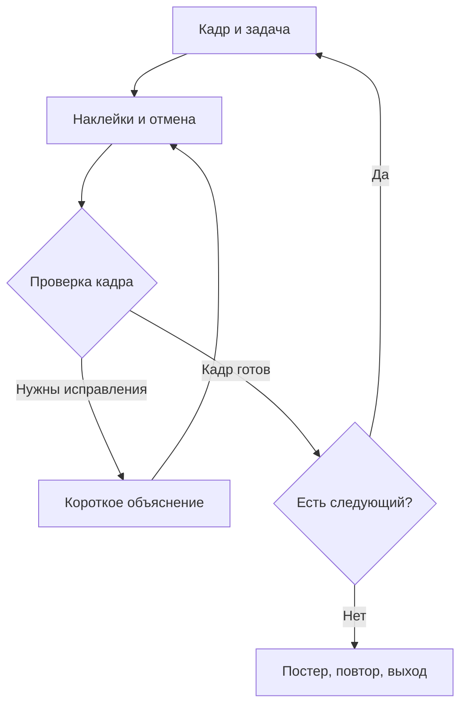

# «Засвет: наклей всё!» — описание и план проекта

Рабочее название. Аудитория: 11–13 лет. Команда: 3 человека. Трек B хакатона СберKids. План подготовлен 17 октября 2026 года.

Этот пакет содержит техническое задание, распределение работы и пример данных. Игровую реализацию команда создаёт по этим инструкциям. Число сцен, интерфейс и внутренние сроки ниже — проектные решения, а не дополнительные требования организаторов.

**1. Короткое описание**

Игрок готовит вымышленный кадр для открытой галереи. На картинке вместе с главным предметом случайно оказались сведения, которые не стоит публиковать: код, пароль или домашний адрес персонажа. Ребёнок закрывает их смешными наклейками, сохраняет видимым главный предмет и получает собственный мемный постер.

Фраза для команды: **«Заметь секреты, закрой их целиком и сохрани смысл картинки».**

Пример: герой фотографирует новый рюкзак, но рядом попали в кадр адрес на коробке и код получения посылки. Игрок приклеивает серьёзный носок и деловое облако поверх этих сведений. Рюкзак и подпись остаются видимыми. Финальная картинка выглядит как намеренно абсурдный коллаж.

Настоящие фотографии, камера, ввод личных данных и свободный ввод текста не требуются. Все сцены, адреса, коды и персонажи вымышленные.

**2. Цели**

| Уровень | Цель | Проверяемое действие |
|---|---|---|
| Учебная | Ребёнок замечает сведения, которые не следует размещать в открытом доступе | В новом кадре самостоятельно закрывает все заданные конфиденциальные области |
| Игровая | Подготовить кадр, сохранив его смысл | Все секреты полностью закрыты, главный предмет и обязательная подпись не перекрыты |
| Продуктовая гипотеза | Ребёнку хочется подготовить ещё один кадр и показать свой коллаж | Повторная попытка или демонстрация результата происходят без просьбы автора |
| Техническая | Показать законченный сценарий в официальной песочнице | Пять сцен, финал, выход и корректные сообщения приложения |

Учебная цель для презентации: **«После игры ребёнок умеет замечать и скрывать личные сведения на изображении перед его открытой публикацией».**

Успех в игре — раннее наблюдение выполнения задачи. Он не доказывает устойчивый навык вне игры. Для проверки переноса последняя сцена отличается расположением предметов и не подсказывает секреты заранее.

Контекст всегда один: **открытая публикация**. Не учим, что адрес нельзя сообщать доверенному взрослому или что код нельзя вводить при собственном входе. Игра тренирует исключение таких сведений из публичной картинки.

**3. Что делает игрок**

1. Нажимает «Начать» и видит задачу одной строкой.
2. Перетаскивает выбранную наклейку на картинку. Альтернативный способ: выбрать наклейку, затем коснуться картинки.
3. При необходимости нажимает «Отменить».
4. Нажимает «Готово».
5. Получает короткое объяснение: что осталось открытым или что важное оказалось закрыто. Исправляет кадр без потери попытки.
6. После удачной проверки переходит к следующему кадру.
7. После пяти кадров получает постер из последнего безопасного кадра. Может поделиться им, переиграть или выйти.

Таймеров, платных попыток и штрафа за размышление нет. Целевая длительность всего прохождения — 3–5 минут; её нужно измерить на прототипе. Если игроки заканчивают заметно быстрее, добавить содержательный кадр или улучшить задачу, а не растягивать анимацию.

**4. Правила первой версии**

- Три типа наклеек имеют одинаковые возможности. Выбор картинки — самовыражение, а не скрытый правильный ответ.
- У каждой наклейки есть полностью непрозрачная прямоугольная подложка. Носок или облако нарисованы поверх неё. Прозрачные участки иллюстрации не раскрывают текст.
- Если центр отпущенной наклейки попал в область секрета, она аккуратно подгоняется под всю область с небольшим запасом. Это облегчает управление пальцем.
- В другом месте используется стандартный размер. Он ограничен: наклейку на весь экран сделать нельзя.
- Секрет считается закрытым, только если его прямоугольник целиком находится внутри непрозрачной подложки хотя бы одной наклейки.
- Частичное закрытие кода не засчитывается. Несколько частичных наклеек не объединяются в сложную маску в MVP; подгонка помогает закрыть область одной.
- Любое пересечение наклейки с обязательной видимой областью мешает завершить кадр. Разметка предусматривает запас вокруг таких областей.
- На кадр доступны четыре размещения; «Отменить» возвращает последнее и освобождает место. Число не является расходуемой наградой.
- Секреты и видимые области не подсвечиваются заранее. Кнопка подсказки даёт помощь по запросу. В последнем кадре она становится доступна после первой неудачной проверки.
- После успешной проверки кадр фиксируется. Дальше доступны переход, выход, а на финале — добровольный шаринг и повтор.

Сплошное заклеивание кадра не выполняет цель: рюкзак, рисунок или другой главный предмет вместе с обязательной подписью должны остаться видимыми. Это правило также отличает игру от свободного редактора наклеек.

**5. Сценарии и юмор**

| ID | Кадр | Что сохранить | Что скрыть | Роль в обучении |
|---|---|---|---|---|
| `frame_01` | Новый рюкзак рядом с коробкой | Рюкзак и подпись | Адрес дома, код получения | Первое знакомство, 2 секрета |
| `frame_02` | Стол перед показом собственного проекта | Рисунок проекта | Учебный пароль, код входа | Повтор правила, 2 секрета |
| `frame_03` | Нелепый чайник на плакате | Чайник | Адрес, код получения, личная заметка с точным местом встречи | Применение в более насыщенном кадре, 3 секрета |
| `frame_04` | Плакат вымышленной команды | Название и иллюстрацию | Домашний адрес, пароль, код | Повтор при другом расположении, 3 секрета |
| `frame_05` | Новый кадр со стола с другой раскладкой записок | Главный рисунок и заголовок | Код, адрес, пароль в новых местах | Самостоятельный перенос, 3 секрета |

Точную личную заметку в третьем кадре показываем как приватное сообщение о встрече у дома персонажа. Общие даты и публичные объявления не объявляем автоматически секретными. Для сомнительной формулировки выбрать более однозначный тип данных.

Три фона переиспользуем, меняя расположение записок и подписи поверх них: `frame_01` — `room.svg`; `frame_02` и `frame_05` — `desk.svg`; `frame_03` и `frame_04` — `poster.svg`. Для контрольного кадра переносим секреты, чтобы запоминание места не заменяло поиск. Новый ракурс фона потребовал бы отдельного рисунка и в этот объём не входит.

Собственные наклейки: серьёзный носок, деловое облако, огурец в режиме полёта. Собственные подписи к итогам: «Кадр готов. Носок на посту», «Облако прикрыло», «Секреты остались за кадром». Эти подписи — предложения, не обязательные реплики.

Шутка относится к ситуации или наклейке. Ошибка ребёнка не становится поводом для насмешки. Не используем обидные оценки, чужие лица, известные мемные персонажи, фрагменты песен и узнаваемые чужие голоса. Бриф требует содержание категории 0+ или 6+; выбранная аудитория 11–13 лет не отменяет это ограничение.

**6. Граница MVP**

Обязательно: пять коротких сцен на трёх фонах; три наклейки; перетаскивание и отмена; полная проверка областей; объяснение ошибки; финал; корректный выход и однократное прохождение; запуск на реальном телефоне в исходной песочнице.

После стабильного полного прохода: PNG-постер и шаринг. Если они не готовы, завершённый игровой результат всё равно показывается внутри игры, но команда честно не заявляет реализованный шаринг.

Дополнительно при наличии времени: два собственных коротких звука, переключатель, тактильный отклик, другая конфигурация сцен. Если звук добавлен, он по умолчанию выключен и включается действием пользователя.

Не включать в первую версию: настоящие фото, камеру, распознавание текста, загрузку файлов, регистрацию, онлайн-галерею, лидерборд, сервер, свободный ввод текста, произвольное масштабирование и вращение наклеек, межсессионную коллекцию.

**7. Что применять и зачем**

| Инструмент или технология | Применение |
|---|---|
| VS Code или другой редактор | Писать собственные HTML/CSS/JS и данные |
| Git и публичный репозиторий | Объединять работу и сдавать код |
| HTML и CSS | Кнопки, тексты, раскладка под телефон |
| Canvas 2D | Единая отрисовка кадра, секретов и наклеек |
| Pointer Events | Обработка мыши и пальца без библиотеки перетаскивания |
| JSON | Сцены, границы, объяснения, порядок кадров и иллюстрации |
| Собственные SVG | Лёгкие фоны и оригинальные наклейки без чужих шрифтов и внешних ресурсов |
| Локальный статический сервер | Разработка и запуск по адресу в песочнице |
| Официальная Android/iOS-песочница | Проверка фактического окружения приложения и событий |

Пользовательский интерфейс расположен в DOM, картинка — в одном Canvas. Проверка не анализирует пиксели фотографии и не распознаёт текст: все области заранее задаются в данных. Это делает объём разработки обозримым.

Canvas и Pointer Events — стандартные возможности браузера. React, Phaser, Tailwind, Lottie-библиотеку и другие сторонние runtime-компоненты для этой игры не подключаем. Все пути внутри папки игры относительные.

**8. Структура будущего репозитория и владельцы**

Это структура реализации. Наличие пути в таблице не означает, что код уже создан.

| Путь | Назначение | Владелец |
|---|---|---|
| `game/index.html` | Оболочка страницы и подключение `src/app.js` как ES-модуля | 2 |
| `game/styles/game.css` | Мобильная раскладка, кнопки, обратная связь | 2 |
| `game/src/app.js` | Сценарий экранов и соединение модулей | 1 |
| `game/src/game.js` | Состояние и правила прохождения | 1 |
| `game/src/geometry.js` | Прямоугольники, подгонка, полное закрытие | 1 |
| `game/src/input.js` | Жесты и перевод координат | 1 |
| `game/src/content.js` | Загрузка и проверка JSON, запасная сцена | 1 |
| `game/src/bridge.js` | Пять событий страницы в приложение | 1 |
| `game/src/ui.js` | Отображение интерфейса и привязка кнопок | 2 |
| `game/src/renderer.js` | Отрисовка Canvas | 2 |
| `game/src/export.js` | Проверенный кадр в PNG | 2 |
| `game/src/audio.js` | Необязательные собственные эффекты | 2 |
| `game/data/content.json` | Полный набор сцен и наклеек | 3 |
| `game/assets/scenes/` | Три собственных фона | 2 |
| `game/assets/stickers/` | Три собственные наклейки | 2 |
| `docs/qa.md`, `docs/demo.md` | Проверки и сценарий защиты | 3 |
| `README.md` | Запуск, ограничения, устройства, вес и ссылки | 3 |

Самый уверенный в JavaScript участник берёт роль 1. Роль 2 сочетает оформление с небольшим объёмом frontend-кода. Роль 3 отвечает за содержание, проверку и сдачу; ему не нужно писать игровое ядро. Если дизайнер не пишет JS, роль 1 помогает с интерфейсом, а роль 2 поставляет рисунки и CSS. В этом случае сначала сокращается декор, а не проверки корректности.

**9. Общий формат данных**

См. [05_content.example.json](./05_content.example.json). В примере одна сцена для согласования формата. Для поставки участник 3 создаёт пять сцен и реальные файлы иллюстраций. Пример сам по себе не является запускаемой игрой.

- `schemaVersion: 1` — версия согласованного формата.
- `board.width: 360`, `board.height: 480` — логический размер кадра, пропорция 3:4.
- Все `rect` имеют вид `[x, y, width, height]` в долях от 0 до 1; это прямоугольники на картинке, не на всём экране.
- `secrets` — области с вымышленным текстом, которые нужно закрыть; `keepZones` — обязательные видимые области.
- `lines` у секрета рисует renderer поверх фона. В фон секретный текст не встраивается: данные и картинка не рассинхронизируются.
- `keepZones.lines` необязателен: если задан, это публичная подпись, которую тоже рисует renderer. Сам герой нарисован в фоне.
- `mode: "practice"` разрешает помощь по запросу; `"transfer"` откладывает её до первой неудачной проверки.
- Пути `./assets/...` разрешаются относительно `game/index.html`, а не относительно расположения JSON.
- Фоны и наклейки не содержат внешних ссылок, скриптов, встроенных шрифтов или удалённых изображений.

**10. Контракт между модулями: согласовать в первые 30 минут**

| Функция | Владелец | Вход и результат |
|---|---|---|
| `loadContent()` | 1 | Возвращает Promise с проверенным конфигом и внутренним `isFallback`; при ошибке — встроенный минимальный конфиг с `isFallback=true` |
| `createLevelState(level)` | 1 | Создаёт пустое состояние сцены |
| `placeSticker(level, state, drop)` | 1 | `drop={stickerId,x,y}`; возвращает `{state,accepted,reason}`; не рисует и не меняет DOM |
| `undoPlacement(state)` | 1 | Возвращает состояние до последнего размещения |
| `evaluateLevel(level, placements)` | 1 | Возвращает `{passed,coveredSecretIds,missingSecretIds,blockedKeepIds}` без изменения состояния |
| `mountUI(callbacks)` | 2 | Привязывает кнопки; возвращает `{canvas,boardElement,paletteElement,rootElement}` |
| `updateUI(viewModel)` | 2 | Показывает тексты, экран, счётчик кадров и доступность кнопок |
| `renderBoard({canvas,level,placements,assets,preview})` | 2 | Рисует кадр, не меняя игровые правила |
| `createPoster({level,placements,assets})` | 2 | Promise с PNG data URL; перед вызовом app проверяет зафиксированный кадр |
| `completeOnce()`, `finishOnce()`, `closeGame()`, `sharePoster(text,image)`, `vibrate()` | 1 | Отправляют существующие события приложения |

`placements` — массив объектов `{id,stickerId,rect}`. `rect` — фактическая непрозрачная подложка, которую одновременно используют проверка, renderer и экспорт. Координаты картинки нельзя повторно «угадывать» в разных модулях.

`callbacks`: `onStart`, `onStickerSelect`, `onUndo`, `onCheck`, `onHint`, `onNext`, `onReplay`, `onShare`, `onClose`; `onSoundToggle` при наличии звука.

`viewModel`: `screen`, `title`, `task`, `levelIndex`, `levelCount`, `stickers`, `selectedStickerId`, `usedStickers`, `maxStickers`, `feedback`, `canUndo`, `canHint`, `canNext`, `canShare`, `posterDataUrl`; `soundOn` при наличии звука. `levelIndex` в интерфейсе начинается с 1. Экраны: `loading`, `start`, `playing`, `levelPassed`, `result`, `error`.

**11. Интеграция с приложением**

Игра использует `window.postMessage(message, "*")`; нативный мост поставляется в песочнице. Он не передаёт данные приложения в игру.

| Событие | Наше правило |
|---|---|
| `CLOSE_EVENT` | Кнопка выхода доступна во всех основных состояниях |
| `FINISH_EVENT` | Один раз при первом полном завершении набора сцен за открытие |
| `COMPLETED_EVENT` | Один раз после успешной проверки всех сцен за открытие |
| `SHARING_EVENT` | Только по нажатию игрока, с уже готовым проверенным PNG и текстом |
| `VIBRATION_EVENT` | Необязательный редкий отклик после удачной проверки |

Флаги отправки прохождения и завершения живут отдельно от состояния переигровки. «Играть ещё» не обнуляет их. `FINISH_EVENT` не закрывает экран: результат остаётся доступным. Запасная сцена при ошибке данных не засчитывает прохождение всего исходного набора: при `isFallback=true` не отправляем `COMPLETED_EVENT`.

Постер пересобирается из зафиксированного безопасного состояния и собственных ресурсов. Непрозрачные подложки физически рисуются в итоговом PNG. Полупрозрачность или обратимое наложение отдельным слоем для экспорта не подходят.

**12. План параллельной работы**

Время ниже — этапы проекта; участники работают одновременно. Календарный запас до дедлайна используется на проверки и отдых, а не на расширение списка функций.

| Этап | Участник 1 | Участник 2 | Участник 3 | Общий результат |
|---|---|---|---|---|
| 0–1 час | Страница, данные, события и простая логика | Оболочка и фон-заглушка | Запуск официальной песочницы, первый сценарий | Своя страница открыта на телефоне |
| 1–4 час | Размещение, отмена, проверка | Canvas и три наклейки | Разметка первого кадра, проверки ошибок | Один кадр полностью проходится |
| 4–8 час | Переходы, подсказки, повтор и защита от дубликатов событий | Остальные фоны, адаптация, экспорт после стабилизации | Пять сцен, объяснения, наблюдения игроков | Весь набор проходится в песочнице |
| 8–12 час | Исправления по устройствам | Читаемость и исправления картинки/постера | Проверка второй платформы по возможности, презентация | Стабильный демонстрационный сценарий |
| Последний запас | Только критичные исправления | Проверка ассетов | Репетиция, публичность репозитория, таблица сдачи | Все материалы доступны организаторам |

Внутренний предел новых функций — до финальной репетиции. Если один кадр не работает к концу 4-го часа, сокращаем эффекты и начинаем с выбора наклейки и касания картинки. Корректность закрытия, отмену и объяснение ошибки сохраняем.

**13. Критерии готовности проекта**

- Все пять сцен проходят от входа до финала, без внешних интеграций.
- Частично закрытый код не засчитывается; прозрачность иллюстрации не раскрывает секрет.
- Закрытый герой или обязательная подпись препятствуют успешной проверке.
- Отмена восстанавливает картинку и результат проверки; достигнутый лимит можно исправить без перезапуска.
- Последняя сцена позволяет наблюдать первую самостоятельную проверку без предварительной подсказки.
- Выход, повтор и события проверены в неизменённой песочнице на реальном телефоне.
- Шаринг, если заявлен, передаёт PNG без видимых секретов и отладочных рамок.
- Проверены ширины 360 и 430 CSS-пикселей и изменение ориентации; жест не прокручивает всю страницу.
- Замерены весь вес файлов и холодная загрузка. Ориентиры брифа: до 5 МБ, до 3 секунд до первого действия, плавная анимация. Это ориентиры оценки реализуемости, а не отдельные автоматические условия снятия.
- Есть презентация, публичный код и ссылка в строке команды в общей таблице.

Приёмка требует презентацию, живой рабочий прототип, публичный код в таблице и работу B в исходной песочнице Android или iOS. Работоспособность на обеих платформах относится к реализуемости; желательно проверить обе. Срок кода на сайте — **18 октября, 15:00**; часовой пояс явно не указан. Уточнить его и поставить внутреннюю сдачу раньше.

**14. Риски и решение**

| Риск | Решение первой версии |
|---|---|
| Получается редактор без обучения | Публичный контекст, конкретные секреты, обязательное сохранение смысла кадра, новая финальная сцена |
| Можно заклеить всё | Ограниченный размер, четыре размещения, видимые области, которые нельзя закрывать |
| Секрет видно через наклейку | Сплошная непрозрачная подложка и одинаковая геометрия во всех модулях |
| Палец закрывает маленький объект | Подгонка наклейки к области и альтернативное управление касанием |
| Веб-версия работает, песочница — нет | Первый запуск на телефоне в первый час, повторные проверки после интеграции |
| Юмор воспринимается иначе, чем ожидала команда | Показать рисунки и реплики нескольким ребятам нужного возраста до полировки |
| Объём не помещается в срок | Сначала полный кадр, затем набор; без вращения, распознавания, аккаунта и настоящих фото |

**15. Кто что читает**

- Все участники читают этот документ и согласуют разделы 4, 9 и 10.
- Участник 1 получает [02_Role_Gameplay.md](./02_Role_Gameplay.md).
- Участник 2 получает [03_Role_Visuals.md](./03_Role_Visuals.md).
- Участник 3 получает [04_Role_Content_QA.md](./04_Role_Content_QA.md).

**Источники требований и API**

- [Ограничения хакатона](https://kids.hackathon.aam.run/#limits), [приёмка](https://kids.hackathon.aam.run/#dod), [сдача](https://kids.hackathon.aam.run/#delivery).
- [Официальная Android-песочница и README](https://github.com/vveidi/sber-hse-hackathon-2026-android).
- [Официальная iOS-песочница и README](https://github.com/vveidi/sber-hse-hackathon-2026-ios).
- [MDN: Pointer Events](https://developer.mozilla.org/en-US/docs/Web/API/Pointer_events).
- [MDN: Canvas drawImage](https://developer.mozilla.org/en-US/docs/Web/API/CanvasRenderingContext2D/drawImage).
- [MDN: Canvas toDataURL](https://developer.mozilla.org/en-US/docs/Web/API/HTMLCanvasElement/toDataURL).
