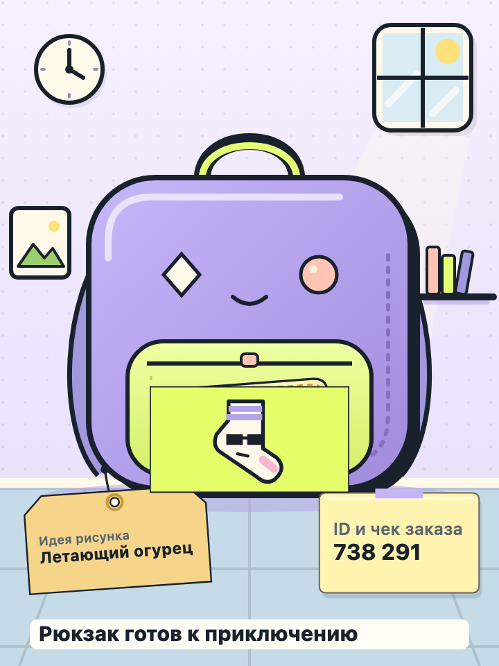
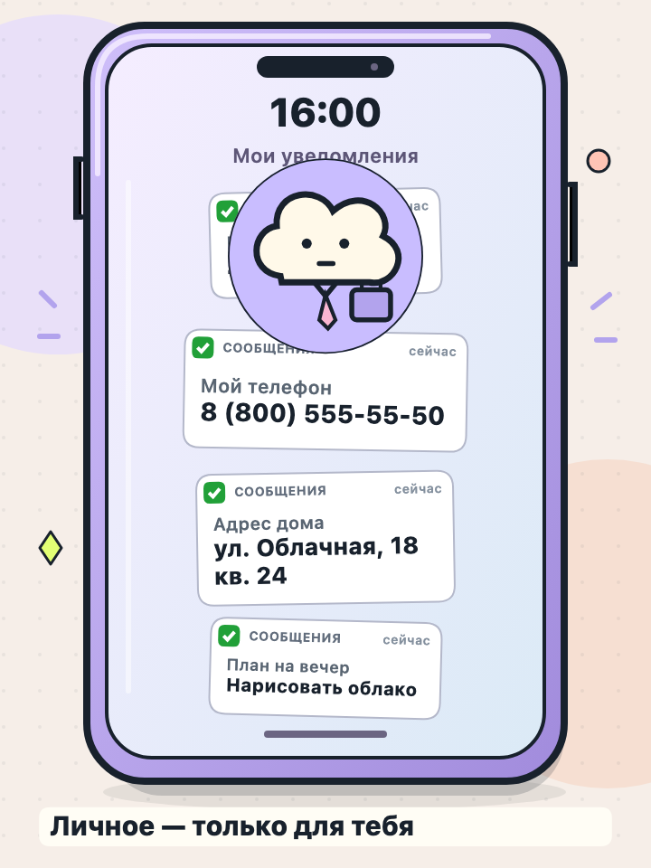
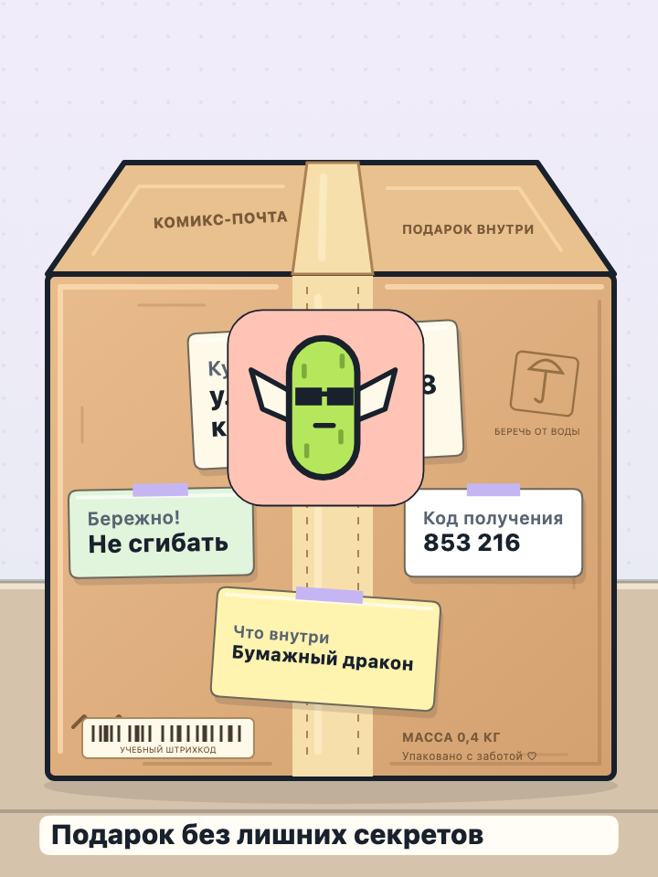

# Засвет: наклей всё!

Игра для трека B «Игры» хакатона СберKids «Создаём эмоции». HTML5-страница для браузера и WebView: пять бытовых сцен, в которых нужно заметить персональные данные и спрятать их под смешными наклейками перед публикацией.

| Рюкзак | Телефон | Посылка |
|:---:|:---:|:---:|
|  |  |  |

Кадры в процессе игры: на фото видны записки и уведомления, а часть личных данных уже закрыта наклейками. Остальные секреты ещё предстоит спрятать.

**Идея.** Ребёнок готовит кадры для открытой ленты. На рюкзаке остался адрес, на телефоне видно СМС с кодом, а на посылке — данные получателя. Нужно прочитать записки, отделить личное от обычного и закрыть секреты носком, облаком или огурцом. После проверки кадр попадает в игровую ленту с лайками и комментариями.

**Чему учит.** Замечать персональные данные на фотографиях и скриншотах, понимать, чем опасна их открытая публикация, и проверять изображение перед отправкой. Обычные идеи, рисунки и подписи при этом нужно оставлять видимыми.

**Аудитория.** Дети 11–13 лет. Все адреса, телефоны, номера и коды — учебные примеры. Переписка и реакции подписчиков вымышленные.

**Управление.** Перетащите наклейку на секрет или выберите её и коснитесь кадра. Наклейки можно двигать, убирать за край и возвращать кнопкой «Отменить». Закройте каждый секрет и нажмите «Готово». Если что-то осталось видно, игра объяснит ошибку и позволит сразу исправить кадр.

**Результат.** Пять подготовленных кадров, итоговое звание и постер PNG, которым можно поделиться через мобильную оболочку. При повторном прохождении расположение записок меняется.

## Пять сцен

| Сцена | Что ищет игрок |
|---|---|
| Рюкзак выходит в свет | Домашний адрес и код заказа |
| Доска заметок | Данные карты, телефон, школу и класс |
| Телефон: секреты на экране | Код из СМС, телефон и домашний адрес |
| Личная переписка | Код для входа из сообщения |
| Посылка готова к отправке | Адрес и код получения |

В игре есть подсказки, реакции персонажа, анимации и собственная синтезированная музыка. Звук включается в настройках. Короткий режим на время переходит в игру в своём темпе; на финальной сцене подсказка появляется после первой проверки.

## Скачать

**[Скачать ZIP](https://github.com/Raistaid/Zasvet/archive/refs/heads/main.zip)** · [Репозиторий на GitHub](https://github.com/Raistaid/Zasvet)

## Технологии

**HTML5, CSS и JavaScript без фреймворков.** Интерфейс адаптируется к размеру экрана, а игровое поле масштабируется вместе с панелью действий. ES modules разделяют логику, ввод, отрисовку и интерфейс.

| Технология | Для чего используется |
|---|---|
| Canvas 2D | Сцены, записки, наклейки, проверка покрытия текста и экспорт PNG 720 × 960 |
| SVG | Собственные фоны и персонажи |
| Pointer Events | Мышь, касания и перетаскивание |
| Web Audio API | Синтез звуков и музыки без аудиофайлов |
| JSON | Уровни, тексты, раскладки и реакции |
| `window.postMessage` | Связь с мобильной оболочкой |
| Node.js | Локальный сервер, тесты и проверки |
| GitHub Actions | Автоматическая проверка проекта |

Игра работает без бэкенда, базы данных и регистрации. Внешние библиотеки, шрифты и CDN не используются. Прогресс хранится в памяти страницы и сбрасывается при обновлении.

## Для разработчиков

Контент находится в [game/data/content.json](game/data/content.json), модули — в `game/src`, стили — в `game/styles`, графика — в `game/assets`.

Проверка учитывает непрозрачную часть наклеек и площадь символов каждого секрета. Текущий допуск `requiredTextFraction: 0.5` требует закрыть половину личного текста; обычную область разрешено перекрывать не более чем на 20%. Пересечения наклеек считаются один раз. Это игровые допуски: экспорт сохраняет фактическое размещение наклеек и не выполняет дополнительное скрытие данных.

```bash
npm test
npm run check:content
npm run check:budget
```

Команды проверяют игровую логику, корректность и решаемость раскладок, а также расчётный бюджет загрузки первого экрана. GitHub Actions дополнительно контролирует размер игры — до 5 МиБ. Расчёт загрузки не заменяет замер на реальном устройстве.

Мобильная оболочка обрабатывает события `CLOSE_EVENT`, `COMPLETED_EVENT`, `FINISH_EVENT`, `VIBRATION_EVENT` и `SHARING_EVENT`. Для интеграции доступны отдельные [Android-](https://github.com/vveidi/sber-hse-hackathon-2026-android) и [iOS-песочницы](https://github.com/vveidi/sber-hse-hackathon-2026-ios).

> `tools/make-assets.py` — исторический генератор, который перезаписывает текущую графику и контент. Для запуска игры он не нужен.
